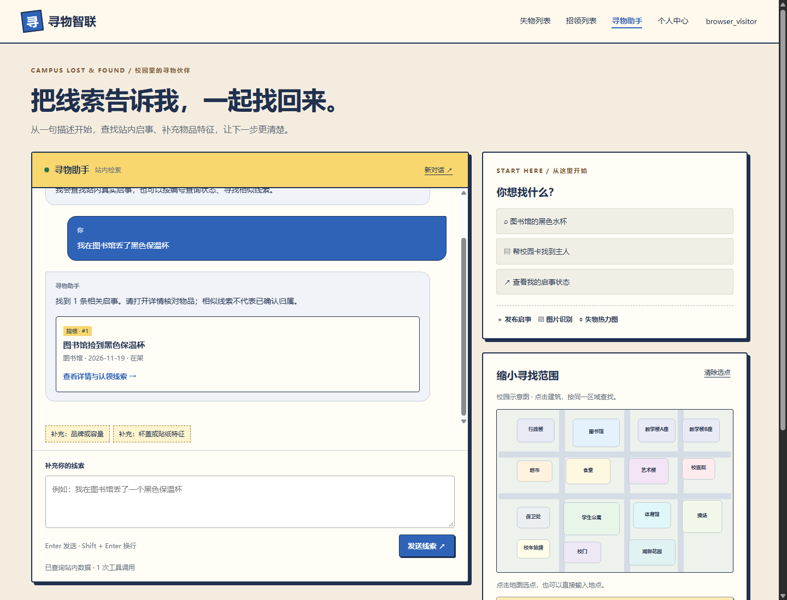
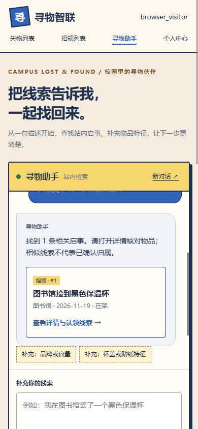

# 寻物助手（UniFound 适配）

## 启动和使用

在本目录运行 npm ci、npm start。打开网站，注册或登录后点击导航中的 **寻物助手**，也可访问同一站点的 **/agent.html** 或 **/agent**。

助手与网站共用一个 Node 进程、SQLite 数据库及 HttpOnly 登录会话，无需另启 Python、React 或 MCP 服务。Dockerfile 已包含 agent/，原有 Compose 部署方式继续适用。默认无需模型密钥；新数据库没有启事时会如实提示无结果，先从网站发布页面录入数据即可。

| 需求 | 输入示例 / 操作 |
| --- | --- |
| 丢了东西，查招领 | 我在图书馆丢了黑色保温杯 |
| 捡到东西，查失主 | 我捡到了一张校园卡 |
| 多轮补充 | 蓝色的 / 不限颜色 / 全校，或点击补充特征按钮后填写 |
| 其他物品名称 | 我丢了“绘图板”（名称加引号） |
| 相似启事 | 查找与物品 12 相似的启事 |
| 启事状态 | 查看物品 12 / 我的发布 |
| 附近 | 地图选点后点击“查找选点附近的物品” |
| 联系方式 | 结果 → 详情 → 完成网站防冒领问答 |
| 图片与发布 | 从侧栏进入现有智能识别或发布页面 |

示例编号须替换为实际存在的启事。相似分数是名称、分类、颜色、地点与日期的规则评分，不是物品归属概率。

## 可选模型配置

在服务器 .env 中配置并重启服务，再在助手页面“查询方式”中主动选择模型辅助：

~~~dotenv
AGENT_PROVIDER=openai_compatible
AGENT_API_KEY=填入你自己的服务端密钥
AGENT_BASE_URL=https://api.openai.com/v1
AGENT_MODEL=填入服务支持的模型名称
AGENT_TIMEOUT_MS=12000
AGENT_JSON_MODE=true
~~~

- OpenAI 兼容服务须支持 Chat Completions。BASE_URL 填 /v1 等前缀，也接受完整 /chat/completions 地址。不支持 response_format 的服务可设 AGENT_JSON_MODE=false，但仍需模型输出 JSON。
- Gemini：设置 AGENT_PROVIDER=gemini、AGENT_API_KEY 和 AGENT_MODEL，AGENT_BASE_URL 留空，使用官方 generateContent 接口。
- 本地模式：AGENT_PROVIDER=heuristic（默认）。模型配置不完整时，页面只开放站内检索。
- 密钥只放服务器；浏览器不存储密钥，也不接受访客提供模型服务器地址。
- 外部服务地址要求 HTTPS，仅 localhost、127.0.0.1 和 [::1] 支持 HTTP 本机服务。地址不得带用户名、密码、查询参数或 fragment。
- 单次模型调用超时范围 1000–30000 毫秒；最多 3 次工具调用，总查询时限 35 秒，模型响应最大 128 KiB。无效工具、错误或超时回退到站内查询。
- 使用模型辅助会发送本轮消息、最近 8 条对话与检索字段，页面有提示。请勿在聊天中输入个人敏感信息。数据库联系方式、问答、描述、发布者身份字段不进入模型工具结果。
- 未使用真实付费模型密钥做外网验收。OpenAI 兼容接口通过本地模拟服务验证，Gemini 请求与响应格式通过适配器测试验证；真实模型名称、额度、服务连通性需由部署方配置后验证。

官方接口参考：[Chat Completions](https://platform.openai.com/docs/api-reference/chat/create)、[Gemini generateContent](https://ai.google.dev/api/generate-content)。

## 地图

复用 CampusMapGL、/api/map/config 和 coordinates.js。未配置 MAP_KEY 与校园标定时使用校园示意图，按同一建筑区域筛选，不将 SVG 坐标当成经纬度或米数。

真实地图开启后使用 GCJ-02 选点，搜索范围支持 500 米、1 / 2 / 5 公里，只对有可用经纬度的记录计算近似直线距离。旧记录可沿用网站的区域标定，标定与记录误差会影响距离。没有使用浏览器 WGS-84 定位，以免与现有坐标混用。配置见 DEPLOY.md。

## 适配设计

| UniFound 原能力 | 本项目实现 |
| --- | --- |
| Python ReAct + MCP 工具 | agent/index.js、tools.js，进程内只读白名单与最多 3 步编排，无额外服务 |
| 中文同义词、物品画像 | profile.js：物品归一化、地点和颜色继承、换物品时重置线索 |
| 多模型 | gateway.js：服务端 OpenAI 兼容 / Gemini；默认本地查询 |
| 搜索、匹配 | 查询当前 SQLite 的在架数据，历史记录限本人或管理员 |
| 认领工单 | 改用本网站防冒领问答、联系方式解锁和 active/resolved/removed 状态 |
| 图片分析 | 引导到网站已有智能识别、发布流程 |
| React 聊天界面 | agent.html、agent.js、agent.css，与原站导航、账号和视觉统一 |

助手不自动发布、认领、修改启事或替用户答防冒领题。模型只规划只读工具，最终结果以数据库记录为准，不采用模型自由生成的联系方式或启事。新页面使用 DOM textContent 展示外部文本，避免将标题或回复当作 HTML。

对话仅在页面内存中保存，刷新或新对话会清空，不写浏览器持久存储。当前规则搜索适合校园规模数据，没有向量数据库或长期会话记忆。更多常见物品可以扩展 profile.js；其他名称使用引号检索。

## 接口

- GET /api/agent/config：登录后返回公开模式信息，无密钥与模型地址。
- POST /api/agent/query：message（1–2000 字符）、history（最多 8 条 user/assistant）、mode（local/model）、可选 location。
- location：真实地图 {lng,lat,radius_m} 或示意图 {mapX,mapY}。
- 返回 final_answer、items、tools_used、steps_count、follow_up_questions 等；FAILED 表示查询未完成。
- 同一用户最多 1 个进行中的请求，进程全局最多 8 个，每用户每 15 分钟 30 次。多实例部署需改用共享限流和并发存储。

## 验证和过程文件

~~~sh
npm run test:agent
node scripts/check-backend-integration.js
node scripts/check-map-compliance.js
node scripts/check-frontend-baseline.js
node scripts/check-recognize-publish.js
node scripts/check-agent-browser.js
~~~

浏览器脚本需要 Chrome，可设置 CHROME_PATH 指向可执行文件。脚本自动创建临时数据库、测试账号及浏览器配置，只在本地临时服务测试，结束后清理。可设置 AGENT_SCREENSHOTS 为截图目录。

2026-11-19 验证环境：Windows、Node.js 24.21.0、Chrome 无头模式。

| 验证 | 结果 |
| --- | --- |
| 助手 API、权限、上下文、模型回退、并发限流、Gemini 格式 | 11/11 |
| 原项目接口、地图、前端基线、识别发布 | 45/45、75/75、7/7、39/39 |
| 注册→发布→答题→热力图→结案 | 19/19 |
| 浏览器桌面与手机 | 1440×1100、390×844，搜索、问答解锁、SVG 点选、新对话、恶意标题文本显示通过，无运行时异常 |

未在本机执行 Docker 镜像构建、真实腾讯地图外网访问或真实模型计费请求；Dockerfile 已同步复制新模块。

过程文件：agent/、scripts/agent.test.js、scripts/check-agent-browser.js 和本文。未上传真实账号、数据库、上传图片和密钥。

桌面（隔离测试数据）：

手机：

## 来源与许可

基于用户提供的 Unifound-main.zip，参考 backend/app/agents/orchestrator.py、llm_gateway.py、chinese_provider.py 与 backend/app/services/chinese_text.py、item_profiles.py 的能力和流程，适配为本项目 Node 模块。

UniFound 使用 MIT License，Copyright (c) 2026 minalprasad08。许可全文保留于 [agent/UNIFOUND-LICENSE](agent/UNIFOUND-LICENSE)。未复制其开发环境、数据库、密钥或部署配置。
